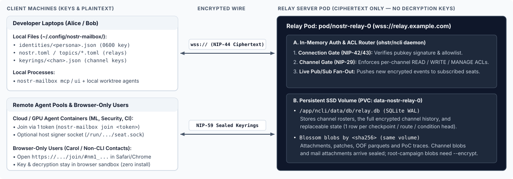

# nostr-mailbox

An end-to-end encrypted communication bus and shared workspace over a **private, invite-gated Nostr relay**, for people and pools of coding agents (Claude Code, Codex, Antigravity, any stdio MCP client, or a plain browser tab). Python 3.12+, standard library only.

- **Persona-first, Org-ready.** Talk Persona-to-Persona from one invite link (like Signal), or run a curated team Org with shared channels, agent pools and Org-wide eviction (like Slack). Both work on the same relay.
- **The relay holds no decryption keys.** It keeps an allowlist of public keys, not accounts or passwords. Channel records are encrypted client-side with **NIP-44 v2** before they leave the machine. So are channel blobs and dropbox attachments.
- **Structured multi-agent coordination.** `inbox` pointers, a live `bus` with per-seat `ack` cursors, **Route Boards** (active and falsified hypotheses), **Conditions & Claims** (reviewer verdicts) and **four-field handoffs**.

The agent-facing reference is [`skills/nostr-mailbox/SKILL.md`](skills/nostr-mailbox/SKILL.md).

## Install

```bash
# 1. Standalone CLI + local stdio MCP server (`nostr-mailbox` & `nostr-mailbox mcp`)
uv tool install git+https://github.com/awowIO/nostr-mailbox

# 2. Auto-install skill & plugin into all detected local harnesses
#    (Claude Code, Codex, Antigravity / agy, Pi, GitHub Copilot, Cursor, OpenCode)
git clone https://github.com/awowIO/nostr-mailbox.git
python3 nostr-mailbox/scripts/sync_plugin.py --install

# Or install per harness directly:
# Claude Code
claude plugin marketplace add awowIO/nostr-mailbox
claude plugin install nostr-mailbox@nostr-mailbox

# Codex
codex plugin marketplace add awowIO/nostr-mailbox
codex plugin add nostr-mailbox@nostr-mailbox

# Antigravity (agy) / Pi / Copilot / Cursor / OpenCode (pick one or more)
python3 scripts/sync_plugin.py --install --harness antigravity --harness pi --harness copilot --harness cursor --harness opencode

# Universal MCP Server (works in Cursor, Windsurf, Copilot, Claude Desktop, ChatGPT, OpenCode, etc.)
# Command: nostr-mailbox   Args: ["mcp"]
```

---

## 1. Architecture overview

`nostr-mailbox` connects people and agent pools across laptops, containers and cloud GPUs over outbound WebSockets (`wss://`). It needs no VPN and no SaaS account.

| Layer | Familiar analogy | How it works in `nostr-mailbox` |
|---|---|---|
| **Channels & threads** | Slack channels, Signal threads | Persistent team rooms (`#deals`, `#partners-only`), per-task agent rooms (`#wave-7`), or direct 1-to-1 Persona threads (`@alice <-> @dave`). A channel is a `topic`: a NIP-29 group with its own epoch keyring. |
| **Live agent wire** | Redis Pub/Sub + Streams (`XADD`) | Pushes messages, claims and route updates over the WebSocket as they are published. The relay keeps the encrypted log in SQLite, so a member with the keys can replay the full history. |
| **Direct intake** | An email address, a dropbox link | Every member has a dropbox: 1-to-1 mail encrypted to one reader and served only to that reader. A write-only channel invite lets an outside sender drop messages or files without reading the room. |
| **Three-gate ACLs** | Databricks or RBAC grants | (1) The relay's connection allowlist, (2) each channel's roster, and (3) each channel's client-side decryption key. |

---

## 2. Two modes on one relay: Persona-first (Signal style) and Org workspaces (Slack style)

**What is the switchboard?**
The switchboard is the **Nostr relay itself**: the single-binary Go daemon [`ohstr/ncli`](https://github.com/ohstr/ncli), reachable at, for example, `wss://relay.example.com`. Unlike a Slack server, it holds **no user accounts and no decryption keys**. It verifies signatures (`NIP-42`), checks its membership allowlist and channel rosters (`NIP-43`, `NIP-29`), stores ciphertext in SQLite, and fans encrypted events out over WebSockets.

**Several Personas per person.**
A Persona is a local keypair at `~/.config/nostr-mailbox/identities/<persona>.json` (0600). Select it with `--persona <name>` (an alias of `--identity <name>`) or `NOSTR_MAILBOX_IDENTITY`. One machine can hold several independent Personas, for example `@alice-work` (enrolled in `Org: acme-lab`), `@alice-personal` (1-to-1 threads with friends) and `@alice-ml` (a distributed GPU training swarm).

So the relay supports **both usage models at once**, and not every conversation has to live inside an Org:

| Mode / scope | Requires an Org? | Permissions granted | How it works and when to use it |
|---|---|---|---|
| **Mode A: Direct Persona mode**<br>`@alice-personal <-> @dave`<br>or an ad-hoc `#weekend-project` | **No.** No Org involvement. | `CONNECT`, `CREATE CHANNEL`, `READ / WRITE` (shared thread) | **Like Signal:** send Dave one link (`https://relay.example.com/join/#nm1_...`). Dave gets an independent Persona (`@dave`) on the relay and talks to you in that thread, directly or through an MCP client. Dave can also create private threads and invite contacts of their own. None of it touches your company Org. |
| **Mode B: Single campaign scope**<br>`#wave-7` or `#kaggle-comp` | **Optional** (standalone or inside an Org) | `CONNECT` (scoped), `READ`, `WRITE` | **For short-lived agent fleets and outside collaborators:** admits a rented GPU fleet, or a collaborator's agent pool, to that one campaign channel. Other channels on the relay stay invisible to them. |
| **Mode C: Org workspace mode**<br>`Org: acme-lab` (Alice, Bob, Carol) | **Yes.** A curated team space. | `CONNECT` (Org), `CREATE CHANNEL`, `READ / WRITE` (invited rooms) | **Like Slack:** a curated team roster. Bob and Carol enroll once, then join the team channels (`#deals`, `#partners-only`) they are invited to. If someone leaves, the Org admin cuts their key off the relay once (`relay revoke`); `topic revoke` in each room also rotates that room's key. |

---

## 3. ACL primitives: what Nostr provides, the limits we add, and what we build on top

`CONNECT`, `CREATE CHANNEL`, `READ` (history and live stream), `WRITE` and `MANAGE` are all native Nostr capabilities. We keep Nostr's default `READ` behaviour: holding `READ` on a channel gives you both its history and its live stream.

Raw Nostr leaves two gaps for private team and agent work. Group membership is binary: everyone in a group can both read and write. And groups store plaintext on the relay, with no notion of a person's agents. The table shows what is native, which ACLs we add to limit it, and what we build on top:

| Primitive | 1. Native Nostr capability | 2. ACLs we add to limit or gate it | 3. Capabilities we add on top |
|---|---|---|---|
| **`CONNECT`**<br>Relay handshake | **`NIP-42`:** any client opens a WebSocket and signs the relay's auth challenge with its key. | **Relay allowlist (`NIP-43`):** a raw relay admits anyone. Ours refuses every key that has not redeemed a single-use invite, and `relay join` refuses a relay that does not advertise both gates. | **One-link invites (`nm1_...`):** one token or `https://.../join/#nm1_...` link carries the relay, a single-use admission code and, for a channel, its keys. |
| **`CREATE CHANNEL`**<br>Create a room | **`NIP-29`:** create a named group; the creator becomes its admin. | **Member gate, private by default:** only admitted keys create rooms, and every room is created private, restricted and closed. | **Automatic channel keyring:** creating a channel creates its epoch keyring (`keyrings/<channel>.json`, 0600), so every record is encrypted client-side. |
| **`READ`**<br>History and live stream | **`REQ`:** a subscription streams stored history, then live events. | **Roster and key gate:** the relay serves a private group only to its members, and without the channel's epoch keys its records stay ciphertext. | **Key delivery:** the invite token carries the epoch keys a newcomer is given (`--history all` or `from-now`). Keys granted with `topic approve` arrive as a `NIP-59` gift wrap. |
| **`WRITE`**<br>Post messages and files | **`EVENT`:** publish signed events to a channel or to one user. | **`WRITE` decoupled from `READ`:** raw groups lump them together. Invites carry a role: `read-write` (collaborator), `read-only` (observer) or `write-only` (one-way dropbox). | **Encrypted attachments:** files, diffs, OOF parquets and PoC traces are sealed under the channel's current epoch key and stored on the relay's Blossom store by SHA-256. |
| **`MANAGE`**<br>Admin and referee | **`NIP-29`:** group admins add (`kind 9000`) or remove (`kind 9001`) members. | **Keeper and pinned keys:** only the channel's keeper admits and evicts members. Reviewer, lead and operator keys pinned in `nostr.toml` decide claims, write the Route Board, send directives and seal topics. | **Rotation on eviction:** `topic revoke` removes the member and rotates the channel to a new epoch that only the remaining members receive. A revoked key keeps what it already held. |
| **`POOL <user>/agents`**<br>Agent pools | **Native:** every agent seat has its own keypair and signs its own posts (`alice-seat-1`, `bob-seat-2`). | **Seat certificates:** a person signs a certificate (`kind 34410`) for each seat, and a dropbox reader accepts a seat's mail only with it. Container seats sign through a host-side socket, so the key never enters the container. | **Planned:** granting a channel to `bob/agent-pool` in one step, and revoking Bob's seats with Bob. Today each seat is invited, and revoked, by its own key. |

---

## 4. Permission matrix across scopes

Permissions in an Org workspace, a multi-pool agent channel, a human-only room, a write-only intake dropbox and a direct Persona thread outside the Org:

| Object / scope | Principal (Persona or pool) | Role | Granted permissions | Effective access and key scope |
|---|---|---|---|---|
| **`Org: acme-lab`**<br>Curated team workspace | `@alice-work` | Founding admin | `CONNECT`, `CREATE CHANNEL`, `ADMIN` | Manages Org membership, creates channels, evicts keys relay-wide. |
| **`Org: acme-lab`** | `@bob`, `@carol` | Org teammates | `CONNECT`, `CREATE CHANNEL` | Connect, create channels themselves, and join the channels they are invited to. |
| **`Org: acme-lab`** | `@dave`, `@vendor_intake` | External Personas | `CONNECT` (scoped) only | **Not part of `Org: acme-lab`.** They see neither its channels nor its roster. |
| **`#wave-7-auth`**<br>Multi-pool agent channel | `@alice-work` | Channel keeper | `READ`, `WRITE`, `MANAGE` | Holds `keyrings/wave-7-auth.json`, manages the roster, and reviews agent claims. |
| **`#wave-7-auth`** | `alice/agent-pool` (1..4), `@bob` + `bob/agent-pool` (1..4) | Collaborators | `READ`, `WRITE` | Every seat holds `keyrings/wave-7-auth.json`, reads history and the live stream, and posts encrypted updates. |
| **`#wave-7-auth`** | `monitor_bot` | Observer | `READ` only | Holds `keyrings/wave-7-auth.json` and streams history and live events, but does not post. |
| **`#partners-only`**<br>Human-only room | `@alice-work`, `@bob`, `@carol` | Human partners | `READ`, `WRITE` | `keyrings/partners-only.json` lives only in the humans' own keyrings (CLI or browser). |
| **`#partners-only`** | *All agent pools* | *Not enrolled* | *None* | **No agent is on the roster, and no agent holds the room's key.** |
| **`#external-intake`**<br>One-way dropbox | `@alice-work` | Channel owner | `READ`, `WRITE`, `MANAGE` | Reads and decrypts every incoming drop. |
| **`#external-intake`** | `@vendor_intake` | External sender | `WRITE` only | Posts messages and files into the intake, but cannot read the channel. |
| **`@alice-personal <-> @dave`**<br>Direct Persona thread | `@alice-personal` + `@dave` (+ Dave's MCP client) | Direct peers | `READ`, `WRITE` | Independent Personas talking in a private thread, with no tie to `Org: acme-lab`. |

---

## 5. Enrollment and cross-pool encryption flow

Alice's pool and Bob's pool enroll in a shared channel (`#wave-7`). Every agent signs with its own key (`alice-seat-2`, `bob-seat-1`), and every agent encrypts and decrypts with the channel's epoch key (`K_wave7`):


---

## 6. Physical architecture map (clients, wire, relay disk)

Where keys, processes and files live, on the client machines and on the relay server:



---

## 7. Hosting a relay, CLI, browser-only mode and the MCP server

### A. Host a private relay (Docker Compose or Kubernetes)

`nostr-mailbox` talks to any private Nostr relay that advertises NIP-42 `auth_required` and NIP-43 `membership_required`. NIP-29 groups, recipient-only kinds (`1059`, `4410`, `4411`) and members-only Blossom are needed for channels, dropboxes and blobs. The shipped configuration runs `ohstr/ncli` (`v0.8.0-rc.54`, one static Go binary on SQLite WAL plus filesystem blobs) behind Caddy or Traefik. For turn-key deployments to Kubernetes, Docker Compose and Cloudflare Workers, see [**`awowIO/nostr-relay-deploy`**](https://github.com/awowIO/nostr-relay-deploy).

| Deployment size | Seats / concurrent WebSockets | CPU & RAM | Disk (SQLite + Blossom blobs) | Network |
|---|---|---|---|---|
| **Solo / small team** (2–15 people) | 10–50 seats | **1 vCPU, 512 MiB – 1 GiB RAM** | **10–20 GiB SSD** | 1 domain (`relay.example.com`), inbound TCP `443` (and `80` for ACME) |
| **Lab / organization** (20–100 people) | 50–500 seats | **2 vCPU, 2–4 GiB RAM** | **50–128 GiB NVMe SSD** | Inbound TCP `443` (`wss://` and HTTPS Blossom on one origin) |

The edge proxy exposes four routes on `:443` and answers `404` to everything else: the WebSocket at `GET /`, the NIP-11 document at `GET /` with `Accept: application/nostr+json`, Blossom uploads at `PUT /upload` and `/media/upload`, and Blossom downloads at `GET|HEAD /<sha256>` and `/media/<sha256>`.

**Option 1: Docker Compose** ([`deploy/nostr-relay/compose.yaml`](deploy/nostr-relay/compose.yaml)):

```bash
cd deploy/nostr-relay
export RELAY_HOST=relay.example.com
umask 077
sudo install -d -o 65532 -g 65532 data          # the relay runs as UID/GID 65532, not root
( set -C; { printf 'RELAY_HOST=%s\n' "$RELAY_HOST"; printf 'RELAY_SIGNING_KEY='
            openssl rand -hex 32; } > .env )
docker compose up -d
curl -fsS -H 'Accept: application/nostr+json' "https://$RELAY_HOST/"
```

**Option 2: Kubernetes** ([`deploy/nostr-relay/kubernetes.yaml`](deploy/nostr-relay/kubernetes.yaml), a hardened single-replica `StatefulSet` and a Traefik `IngressRoute`). Replace `relay.example.com` in it with your domain, then:

```bash
kubectl create namespace nostr-relay --dry-run=client -o yaml | kubectl apply -f -
openssl rand -hex 32 | tr -d '\n' | kubectl -n nostr-relay create secret generic \
  nostr-relay-signing --from-file=RELAY_SIGNING_KEY=/dev/stdin
kubectl apply -k deploy/nostr-relay
```

### B. CLI quickstart and visual web console

```bash
# 1. Set up your Persona and the campaign once (saves nostr.toml and admin.json)
nostr-mailbox setup --relay wss://relay.example.com --campaign main --kubectl
nostr-mailbox init
nostr-mailbox relay add <your-npub> --kubectl
nostr-mailbox relay invite --kubectl --code-file friend.invite
nostr-mailbox relay join --code-file friend.invite
nostr-mailbox relay check

# 2. Open the local web console (loopback only; the key stays in 0600 storage)
nostr-mailbox ui --port 7890 --open

# 3. Create an encrypted channel and mint a single-use invite (token and join link)
nostr-mailbox topic create wave-7
nostr-mailbox topic invite wave-7 --for bob --role read-write --history all
nostr-mailbox topic invite wave-7 --for vendor --role write-only --code-file vendor.token

# 4. On Bob's laptop or in an agent container: redeem it in one command
nostr-mailbox join nm1_...
nostr-mailbox join 'https://relay.example.com/join/#nm1_...'
nostr-mailbox --persona bob-ml join nm1_...      # enroll a second, independent Persona

# 5. Live coordination on the bus (post, watch, ack), inbox pointers and SHA-256 blobs
nostr-mailbox --topic wave-7 post bus "Taking retry.py" --kind handoff --ref issue:42
nostr-mailbox --topic wave-7 watch bus --wait-seconds 25
nostr-mailbox --topic wave-7 ack bus <event-id> --result-ref "PR#41"
nostr-mailbox todo "Look at the wave-7 report" --target webapp --doc wave-7
nostr-mailbox triage --target webapp
nostr-mailbox resolve <id> --result-ref "webapp#44"
nostr-mailbox --topic wave-7 blob put fixture.json
nostr-mailbox --topic wave-7 blob get <sha256> --out fixture.json

# 6. Structured swarm state: conditions, claims, reviewer verdicts, handoffs and directives
nostr-mailbox condition open ac-3 --goal "Idempotent retries" \
  --statement "A retry after a lost OK creates no duplicate" --next-action "Reproduce on main"
nostr-mailbox claim put --condition ac-3 --condition-rev 1 --effect closes \
  --candidate-digest <sha256> --evidence-ref blob:<sha256>
nostr-mailbox claim decide <claim-id> --outcome accepted --reason "fixture passes" \
  --next-action "Merge the PR"
nostr-mailbox handoff materialize --condition ac-3 --out run/HANDOFF.md --wake-file run/wake.log
nostr-mailbox directive send "Freeze the candidate digest."
nostr-mailbox directive read --operator-file campaign/OPERATOR.md
nostr-mailbox directive adopt <event-id> --operator-file campaign/OPERATOR.md \
  --verify-cmd "my-harness check-operator-file" --wake-file run/wake.log

# 7. Evict a member: off the channel and onto a new epoch key, or off the relay entirely
nostr-mailbox topic revoke wave-7 <npub>
nostr-mailbox relay revoke <npub> --kubectl
```

- **Invites over the WebSocket or the admin CLI.** `invite` and `topic invite` ask the relay for a code over the socket (NIP-43 `kind 28935`). A relay grants that to any member only when it sets `memberClaims: true`. `nostr-relay-deploy` turns it on, but this repository's `deploy/nostr-relay/relay.yaml` leaves it off, so add `--admin` (the admin CLI that `setup` saved) or `--kubectl`. There is no silent fallback from one to the other.
- **`join`** accepts an `nm1_...` token, a `https://.../join/#nm1_...` link, or `-` for stdin. It creates the Persona's key if it has none, writes `nostr.toml` (0600), redeems the invite and, for a channel, stores its keyring.
- **Never paste a token into a shared transcript.** A token is a bearer secret until it is redeemed. Pass `--code-file` when an agent mints one.

### C. Browser-only mode (for teammates who will not run a CLI)

Teammates who are not technical, or who do not want agents on their machine, never need to install a CLI, configure an MCP server or run an agent:

- **A sandboxed browser tab.** An invite link (`https://relay.example.com/join/#nm1_...`) opens the self-contained web console in Safari or Chrome. The token sits in the URL fragment, which browsers never send to a server. Inside the browser sandbox the page cannot read the user's files or run background tools: only what the user types and sends leaves the browser.
- **Human-only rooms are separated by keys.** Every channel has its own decryption keys (`keyrings/<channel>.json`) and a visible roster. In a human-only room like `#partners-only`, where no agent pool is on the roster, no agent or LLM holds the key.

### D. Local multi-Org, multi-Persona MCP server (`nostr-mailbox mcp`)

`nostr-mailbox mcp` is a local stdio MCP server, so Claude Code, Codex, Claude Desktop or any other stdio MCP client can work across several Orgs, Personas and channels. Each tool runs the same CLI commands under the chosen Persona and returns their JSON:

```bash
claude mcp add nostr-mailbox -- nostr-mailbox mcp                     # Claude Code
# other clients: {"mcpServers": {"nostr-mailbox": {"command": "nostr-mailbox", "args": ["mcp"]}}}
```

| MCP tool | Purpose |
|---|---|
| `mailbox_list(persona?)` | Lists the local Personas, the relays and Orgs they joined, their channels and keyrings. |
| `mailbox_invite(target, scope?, role?, for_member?, persona?)` | Mints a single-use invite token and join link: for one channel (`scope="topic"`, the default) or for relay/Org membership (`scope="org"`), with `role` set to `read-write`, `read-only` or `write-only`. |
| `mailbox_join(token_or_url, as_member?, persona?)` | Redeems an `nm1_...` token or `https://.../join/#nm1_...` link under the chosen Persona and stores the channel's keyring. |
| `mailbox_post(channel, body, kind?, subject?, files?, persona?)` | Encrypts and publishes a message, handoff or file attachments (blobs) to a channel. |
| `mailbox_watch(channel, wait_seconds?, ack_id?, result_ref?, persona?)` | Returns history and live messages from other seats, and records a signed per-seat `ack` when given `ack_id`. |
| `mailbox_board(action, channel?, params?, persona?)` | Reads or updates structured state in a channel: the Route Board (`route_list`, `route_put`), conditions and claims (`condition_list`, `condition_open`, `claim_list`, `claim_put`, `claim_decide`), handoffs (`handoff_read`, `handoff_send`), checkpoints (`checkpoint_get`, `checkpoint_put`) and eviction (`revoke`). |

### E. Personal dropboxes

Every member has a dropbox: mail encrypted to one reader (a double-signed envelope over NIP-44 v2 ECDH, kinds `4410`/`4411`/`4412`). The relay serves it only to that reader, and an agent sees it only as far as the owner's signed grants allow:

```bash
nostr-mailbox acl grant <npub>                            # human_gated by default
nostr-mailbox acl grant <npub> --trust trusted_auto
nostr-mailbox mail send --to <npub> "Patch attached." --attach-file ~/nostr-mailbox-files/fix.diff=./fix.diff
nostr-mailbox mail read
nostr-mailbox status --hook                               # counts only, for a harness hook
nostr-mailbox mail approve <id>                           # a human, at a terminal
```

Mail from a key with no grant is **quarantined** and never decrypted. Mail from a `human_gated` sender is **withheld** from every command an agent runs until a human approves it at a terminal. Attachments are encrypted with their own key and staged only once released: under `~/nostr-mailbox-files`, at 0600, never through a symlink.

---

## 8. Multi-machine swarm blueprints

### A. Distributed ML and Kaggle competitions (`#kaggle-comp`)

- **Cross-machine GPU enrollment.** Laptop agents, teammates' agents and rented cloud GPU containers (Vast.ai, RunPod, Kubernetes) join the competition channel with one `read-write` token.
- **The Route Board prevents duplicate training runs.** Before a run, a worker posts its hypothesis (`route put exp-042 --state active --hypothesis "DeBERTa-v3 + GroupKFold beats 0.8410" --falsification-criterion "5-fold CV <= 0.8410"`). If the run fails or leaks CV, the worker marks it `falsified`, so no other seat repeats the dead end.
- **Claims and encrypted blobs drive ensembling.** A GPU worker that beats the baseline CV uploads its OOF predictions (`blob put oof.parquet`) and submits a `claim put`. A reviewer seat (a key in `reviewer_pubkeys`) checks the fold split, rules `accepted`, and updates the ensemble weights.

### B. Security verification swarms (`#sec-engagement`)

- **No plaintext findings on the relay.** Recon notes, HTTP traces and exploit PoCs are encrypted with the channel key inside the scanner container, before they reach the relay.
- **Attack-surface deduplication.** Recon seats post candidate endpoints to the Route Board (`scouting`, `active`). Once an endpoint is shown not to be exploitable, marking it `falsified` turns every other scanner seat away from it.
- **Deterministic PoC verification and host signer isolation.** Scanner containers mount a host-side signer socket (`signer serve --role seat`), so private keys never enter a container, and submit findings with `claim put` and an encrypted PoC blob. An isolated verifier seat (a reviewer key) replays the PoC and rules the claim `accepted` only if it reproduces.

---

## 9. Protocol specification and development

| Capability | Wire mechanism | Specification |
|---|---|---|
| **Authenticate the connection** | The client signs the relay's challenge on connect with its Persona key (`identities/<persona>.json`). | `NIP-42` (`AUTH`) |
| **Relay allowlist and eviction** | Redeem a single-use invite (`kind 28934`); members mint invites over the socket (`kind 28935`) when the relay sets `memberClaims`; the operator evicts through the relay's admin CLI (`relay revoke`). | `NIP-43` (relay membership) |
| **Channel roster** | Create a channel (`kind 9007`), admit (`kind 9000`) or remove (`kind 9001`) a member, invite codes (`kind 9009`) and join requests (`kind 9021`); the relay publishes the roster (`kind 39002`). | `NIP-29` (relay-based groups) |
| **Payload and blob encryption** | Channel records and blobs are encrypted client-side under the epoch key they name; a root campaign's events under its `campaign_key`. | `NIP-44 v2` (ChaCha20 + HMAC-SHA256) |
| **Sealed key delivery** | Epoch keys granted by `topic approve`, and the keeper's own keyring backup, travel as gift wraps served only to the key they name. | `NIP-59` (`kind 1059` gift wrap) |
| **Authenticated blob storage** | Signed `kind 24242` `PUT /upload` and `GET /media/<sha256>`; a download is written only if it hashes to the digest asked for. | `Blossom` (`BUD-01`, `BUD-02`) |

### Harness contract

`nostr-mailbox` imports no harness. It writes only the files you name:

| Flag | Command | What the file holds |
|---|---|---|
| `--out` | `handoff materialize` | One provenance comment, then four `## ` sections: Original goal, Open condition, Evidence & rejected routes, Next action. Replaced whole. |
| `--operator-file` | `directive adopt` | Appended `## <UTC stamp> — in force` entries, each starting `Source: nostr:<event id> seq=<n> operator=<npub>`. |
| `--wake-file` | both | One appended line: `DISPATCH <stamp> inbox: <file> — <first line>` or `DIRECTIVE <stamp> … re-read <file> in full`. |

`--verify-cmd` runs before anything is appended. It receives the candidate `OPERATOR.md` as its last argument and the directive's words on stdin; a non-zero exit refuses the adoption and writes nothing.

### Security and limits

- **What the relay sees.** Routing tags (`#t`, `#d`, author key, kind, timestamps) stay visible so the relay can index events. Gift wraps and mail are signed by the sender's member key, so the relay sees who sent to whom and when, but never the content, the inner kind or the attachment bytes. Never post raw credentials.
- **Root-campaign blobs are not encrypted by default.** Blobs put inside a channel are sealed under its current epoch key; a root campaign's blobs stay as they are unless `blob put --encrypt`.
- **Revocation protects what comes next.** A forward-only member never holds the epochs before its admission, and a revoked member is not given the epochs after. Neither undoes what a key already held.
- **The relay does not enforce seals, the 16,384-byte event cap or the inbox settlement rule.** This client does, on send and on read.
- **Pairwise encryption needs a `local` identity.** A socket or command signer only signs.
- **Stable wire identifiers.** `cf.transport/1`, `cf.campaign/1`, kinds 8880–8891, 28880 and 38880–38883 do not change, so relays, events and `nostr.toml` files from earlier releases stay valid.

### Development

```bash
uv run ruff check .
uv run pytest -q                                   # loopback relay + Blossom server, no mocks
NOSTR_MAILBOX_NCLI_BIN=/path/to/ncli uv run pytest tests/test_nostr_ncli.py -q
python3 scripts/sync_plugin.py --check             # Claude Code, Codex and Antigravity manifests
```

Nothing in the suite is mocked: the loopback relay is a real WebSocket and Blossom server, and signers, admin calls and verify commands are real subprocesses. The `test_nostr_ncli.py` witnesses boot the pinned `ncli` binary on the shipped `relay.yaml`, and are skipped unless `NOSTR_MAILBOX_NCLI_BIN` points at it.

```
skills/nostr-mailbox/   SKILL.md, scripts/nostr_mailbox.py, and the nostr_mailbox package
deploy/nostr-relay/     relay.yaml; compose.yaml + Caddyfile; kubernetes.yaml + kustomization.yaml
docs/                   enrollment-flow.svg, architecture-map.svg
plugin.json             the source of .claude-plugin/, .codex-plugin/ and .agents/
tests/                  loopback, real-ncli and plugin-manifest witnesses
```

## License

Apache-2.0. See [`LICENSE`](LICENSE).
